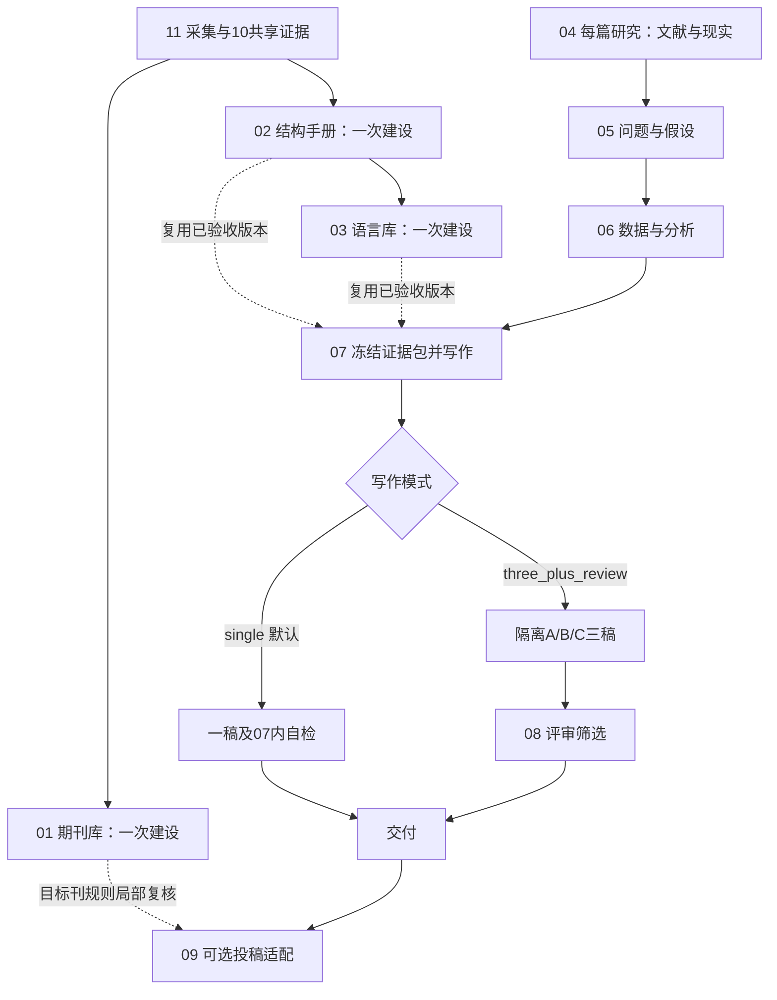

# 项目架构 · 第3版

定位：面向中国定量社会学的证据驱动研究与写作工作流。采用模块化单体、文件证据仓、SQLite结构知识库及可替换的数据/检索/模型接口。先在Windows本地运行，不绑定OpenClaw；未来可通过薄适配层暴露为Skill或命令，研究逻辑留在模块内。

## 一、模块与依赖

| 目录 | 职责 | 上游 | 核心产物 |
|---|---|---|---|
| 00_项目控制 | 注册版本、计划、状态、运行锁和验收记录 | 根规范 | config、run manifest、阶段状态 |
| 01_投稿期刊库 | 一次性建设：100家候选、稿约、渠道、费用和适配 | 10、11 | journals、guidelines、分组名单 |
| 02_文章结构学习 | 一次性建设：20篇全文的节/段/句功能编码与分布 | 10、11 | corpus20、structure_moves、结构手册 |
| 03_学术语言学习 | 一次性建设：同一语料的论证动作和原创句式 | 02、10 | language_rules、原创示例库 |
| 04_议题文献与现实 | 议题定义、六刊联网检索、约100篇摘要、25篇入选全文、政策新闻 | 10、11 | evidence map、core25、context pack |
| 05_研究问题与假设 | 四类缺口、同层级审查、竞争解释、设计 | 04 | hypotheses、theory dialogue、design |
| 06_数据方法与分析 | 先方法库，后CFPS/CGSS变量及实际分析 | 05、10；方法库可提前做 | dictionary、analysis plan、results |
| 07_三稿独立写作 | 沿用目录名；支持单稿/隔离三稿，冻结前置材料 | 02/03资源快照、04、05、06 | frozen pack、A或A/B/C、claims、自检 |
| 08_检查评审与筛选 | 仅three_plus_review启用：三稿比较及交付 | 07 | 审稿表、优胜稿、复现包；single跳过 |
| 09_可选投稿适配 | 随机候选、逐刊格式、顺序投稿状态 | 01资源、07；三稿模式另需08 | 十刊候选与材料；默认不执行 |
| 10_共享证据与契约 | ID、Schema、证据、关系、来源和存储 | 根规范 | SQL DDL、字段词典、证据仓 |
| 11_文献采集适配 | 本地/导出/开放来源统一接口、旧爬虫迁移 | 10 | 标准题录、摘要、合法全文 |
| 12_参考项目与迁移 | 原项目差异、GitHub借鉴、本地资产接入 | 外部资料只读 | 改进清单、来源快照、资产清单 |

00贯穿调度与状态管理；12提供迁移参考。01—03是一次性资源建设流程，各自验收并发布resource_snapshot后复用；每篇研究只建立04—07阶段，08仅三稿模式启用，09独立可选。方法库也可提前积累并长期复用；不能要求先跑数据才准备方法库。

## 二、三类存储与数据流

1. **公共资源库**：各模块当前版本的`assets`、`templates`和共享知识表。20篇语料与方法范例长期保留，原文受授权边界约束。
2. **单次研究工作区**：`00_项目控制/v002_第2版/runs/<run_id>/`。初始化时锁定根规范、模块、配置及模板的SHA-256；每次研究不建立01—03工作区，只绑定共享资源快照；04—07各自工作区，08仅三稿模式建立，09仅在独立启用后建立。每阶段新建`attempt_001`等目录。
3. **冻结包**：单次研究的`frozen/<pack_id>/`，包含不可变manifest和内容哈希。一稿或三稿均读取该包；三稿模式各上下文隔离。不能直接读取其他稿件或未冻结运行结果。

证据链：source_id → paper_id/document_id → evidence_id → relation_id → hypothesis_id → variable_id → model_id/result_id → claim_id → draft_id → review_id → submission_id。每个转换均保留角色与版本；关系可由摘要提出候选，进入正式论证须回查全文。

SQLite承担结构查询，文件仓承担原始PDF/导出/快照，JSON/CSV作为跨模块交换，Markdown承担人读报告。字典、value labels与题目定位单独存，不将复杂元数据塞入CSV表头。个案数据优先保留原始二进制与本地衍生格式，CSV只是可选导出。

## 三、统一模块接口

计划接口：`plan(inputs, config) -> plan`；业务执行接口：`execute(plan, context) -> artifacts`；验收接口：`validate(artifacts, evidence) -> gate_report`；导出接口：`export(artifacts, target_profile) -> files`。模块不得因独立调用而跳过证据和输入检查。

各阶段manifest至少含run_id、stage_id、attempt、module_version、schema_version、status、input_files与sha256、config_sha256、root_requirements_sha256、prompt/model版本（使用时）、代码与运行环境、种子、output_files与sha256、gate_report、异常与时间。阶段2之后锁定所有直接上游的manifest哈希。

运行状态：`planned → ready → running → needs_review / failed / passed`；输入变化可转`stale`，可选阶段可为`skipped`。`passed`表示业务验收通过，不能由目录存在推出。00提供计划、初始化和结构检查。04—07各自提供阶段执行工具，研究验收依赖真实材料和对应复核。

## 四、关卡

| 关卡 | 放行条件 | 失败动作 |
|---|---|---|
| G1 期刊 | 两池各50且去重100，资质有当期证据，逐刊字段完整；未知明示 | 补核验，不自动入可投池 |
| G2 语料 | ≥20完整定量论文，两刊均覆盖，页码和全文状态有效 | 扩充或换样，不能据摘要归纳全文 |
| G3 语言 | 所有规则有语料依据，原创示例与原句分开 | 删除无依据规则 |
| G4 议题 | 六刊逐篇联网凭据、摘要目标与缺口报告、25篇入选全文、政策新闻与关系证据 | 补检索，维持未完成 |
| G5 假设 | 同层级、可证伪、对话、反证、测量可行、设计冻结 | 回到04或修改问题 |
| G6 实证 | 使用的方法各2范例；数据可读、变量可追、模型合适、复现与诊断通过 | 回到变量/设计，保留失败日志 |
| G7 写作 | single：一稿与必要自检；three_plus_review：同包三稿隔离；两者均须数字与引用有据 | 重建失效稿件 |
| G8 可选筛选 | 仅three_plus_review启用：无致命问题、评分合格、至少一稿通过；single为skipped | 无胜出或返工，禁止强制选优 |
| G9 投稿 | 显式启用、逐刊最新稿约、真实作者与声明、同稿族没有未结束在审 | 停在材料准备状态 |

## 五、提供方与扩展

- `LiteratureProvider`：search/query、export_metadata、resolve_fulltext；实现本地Zotero、授权CNKI导出、期刊官网、公开元数据。返回明确授权和获取状态。
- `DatasetAdapter`：discover、read_metadata、read_subset、harmonize；初版计划CFPS、CGSS，新增库无需改写研究问题模块。
- `AnalysisEngine`：Stata/R/Python三选或组合，输出统一result schema；Stata14作为候选兼容目标，执行前检查实际软件与命令支持。
- `ModelProvider`：模型、提示、预算、重试单独配置；默认不配置API、不发个案数据。
- `DocumentRenderer`：Markdown中间稿→目标Word/PDF，后续接文档渲染和视觉验收。

默认本地单进程足够。独立三稿表示信息隔离，不要求同时跑代理；未来只有获得明确任务授权后才引入并行代理。

## 六、当前完成度

模块实现和业务实跑分别记账，见[当前状态](00_项目控制/v003_第3版/outputs/当前状态.md)。第07步已经产出写作任务，正式稿仍需要写作者或离线起草工具提交。
