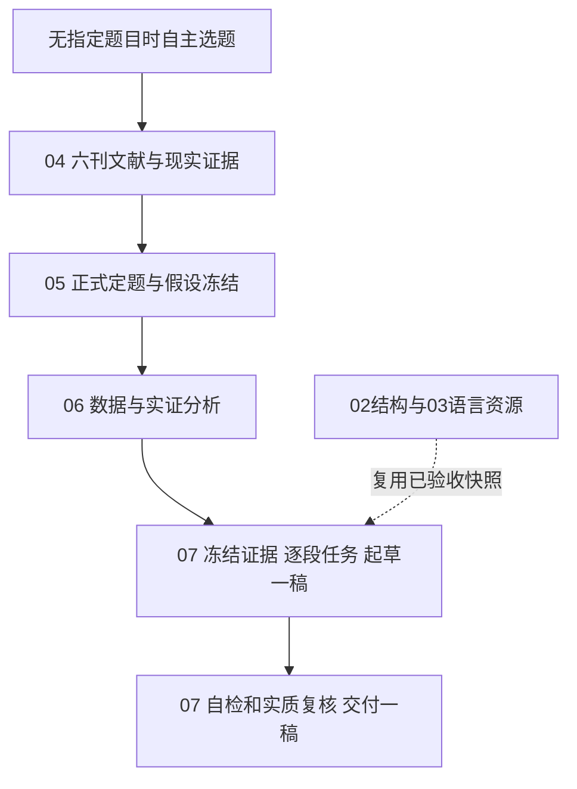

# 选题与自动论文流程

## 默认先选题

启动新论文时，由执行者根据[五刊选题 Skill](../../05_研究问题与假设/v008_第8版/skills/social-science-topic-selection/SKILL.md)、近期现实或政策线索、CFPS/CGSS等可用数据，提出并比较候选。每题写清人群、时间、比较和结果指标，核对原问卷、题项跳转、编码与样本可行性。对照一个较简单的问法，说明不同答案会改变哪项理论判断或实际决策。材料够用时选出一个优先方向，记录备选与取舍。候选都不合格时，继续补证或换方向。

无题启动返回选题任务。执行者完成裁决后，用裁决记录初始化同一运行标识。裁决 JSON 至少含 theme、issue、status，选中的状态为 selected_for_stage_04。记录应附候选比较、来源与尚待核对的问题。

```powershell
python .\00_项目控制\v005_第5版\tools\project.py init --run-id my_study
python .\00_项目控制\v005_第5版\tools\project.py init --run-id my_study --topic-decision <项目内选题裁决JSON>
```

第二条命令将裁决文件路径与 SHA-256 绑入运行清单。用户给出主题时，可用 --theme 与可选的 --issue、--question 直接传入线索。优先方向进入04查重和补证，正式题目与假设在05通过后冻结。

## 默认单稿流程图



01—03为一次性公共资源。默认08跳过，09关闭。08仅在显式改用三稿模式时启用。

07依次核对上游关卡，锁定证据、写作架构、文字要求及语言资源，形成提纲和逐段任务，起草一篇并填写参考文献、事实与实证数字台账。完成架构与语言检查、引文和数字逐项校验及实质复核后，导出稿件、自检记录和复现材料入口。[第七步实际命令](../../07_三稿独立写作/v014_第14版/使用说明.md)

## 本轮选题

优先推进 CFPS2022 的一个具体比较。在已签约且约定期限的成年非农受雇者中，比较报告与派遣或中介单位签约、未报告与这类单位签约两组自报工作提供工伤保险的比例。

现有筛查中，两组有效工伤保险答项分别为 839 人和 2,965 人。候选用于检验签约者内部的用工组织差异，问卷可支持自报供给比例的关联比较。G4还须核对同题研究及理论增量，G5还须核对岗位可比性、抽样、缺失和估计精度。[本轮选题裁决](outputs/首轮自主选题裁决.json) · [问卷、样本和政策依据](../../05_研究问题与假设/v006_第6版/outputs/五刊逐篇审读_20261118_attempt001/按Skill实际选题.md)
